# Detailed Story of [Dahyun](https://github.com/HongDaHyun)
## Table of Contents
  * [**1. Outline**](#1-outline)
    + [1.1. Profile](#11-profile)
    + [1.2. Educations](#12-educations)
    + [1.3. Skills](#13-skills)
    + [1.4. Team Projects](#14-team-projects)
      - [1.4.1. RudenSmith](#141-rudensmith)
      - [1.4.2. HIM](#142-him)
      - [1.4.3. CookieLabs](#143-cookielabs)
      - [1.4.4. TurtleRun](#144-turtlerun)
      - [1.4.5. Boulangerie](#145-boulangerie)
    + [1.5. Personal Projects](#15-personal-projects)
  * [**2. Introduction**](#2-introduction)
    + [2.1. Where It Began](#21-where-it-began)
    + [2.2. Self Improvement](#22-self-improvement)
    + [2.3. Solo Indie Development](#23-solo-indie-development)
    + [2.4. Documentation](#24-documentation)
    + [2.5. Performance and Code Quality](#25-performance-and-code-quality)
    + [2.6. Assets and Tools](#26-assets-and-tools)
    + [2.7. Recent Update](#27-recent-update)
  * [**3. Beyond Development**](#3-beyond-development)
    + [3.1. Design](#31-design)
      - [3.1.1. Pixel Art](#311-pixel-art)
      - [3.1.2. Hand drawn Illustration](#312-hand-drawn-illustration)
    + [3.2. Marketing](#32-marketing)
      - [3.2.1. Instagram](#321-instagram)
      - [3.2.2. YouTube](#322-youtube)
      - [3.2.3. Trailer Video](#323-trailer-video)
      - [3.2.4. DCInside](#324-dcinside)
    + [3.3. Planning](#33-planning)
      - [3.3.1. 애니제라블 기획서](#331-애니제라블-기획서)
      - [3.3.2. 알티디 역기획서](#332-알티디-역기획서)
      - [3.3.3. 택틱스 어드벤처 기획서](#333-택틱스-어드벤처-기획서)

## 1. Outline
### 1.1. Profile
이름: 홍 다현

  - 생년월일: 2002-04-30
  - 연락처: 010-9271-5476
  - Github: https://github.com/HongDaHyun

### 1.2. Educations
가천대학교, 2021-03 ~ 2027-08

  - 주전공: 컴퓨터공학과
  - 복수전공: 창업융합학과(코코네스쿨)
  - 학점: 4.17 / 4.50

고등학교 시절부터 저는 "언젠가 내 손으로 직접 게임을 만들겠다"는 꿈을 품고 있었습니다. 그 꿈을 실천에 옮긴 건 대학생이 되고 나서였습니다. 누가 가르쳐주지 않아도 스스로 게임 개발을 독학하기 시작했고, 자연스레 "내가 만든 게임으로 직접 창업까지 해보고 싶다"는 목표로 이어졌습니다.

그러던 중, 저희 학교가 일본의 IT·콘텐츠 기업 코코네(Cocone)와 협력하여 설립한 창업 교육 기관 '코코네스쿨' 1기 모집 소식을 접했습니다. 지원 끝에 1기 멤버로 합격했고, 이를 계기로 [RudenSmith](#141-rudensmith)라는 팀을 직접 꾸려 게임 [애니제라블(Aniserables)](https://github.com/HongDaHyun/ProjectAI)을 개발했고, 최종 평가에서 당당히 합격하였습니다.

RudenSmith팀이 해체된 이후에도 도전은 멈추지 않았습니다. HIM 팀의 일원으로 들어가 앱도 만들어보고, 이후에는 지금은 어엿한 기업으로 성장한 [CookieLabs](링크)에 초기 스타트업 멤버로 합류해 게임 프로젝트를 총괄하기도 했습니다.

### 1.3. Skills
저는 C#과 Unity 엔진에 능숙하며, C++, Java, Python 등 다른 언어도 문제없이 다룰 수 있습니다.

Aseprite로 직접 게임을 디자인해오며 애니메이션과 UI에 대한 이해를 쌓았고, 디자인과 개발 사이의 최적화까지 함께 고려할 수 있다는 점이 차별점입니다.
마지막으로, 레벨 디자인을 포함한 게임 데이터를 JSON과 CSV로 다뤄왔으며, 군 복무 중 셀 프로그램을 직접 만들어보며 엑셀에 대한 이해를 한층 높였습니다.

Skill        | Experiences | Note
-------------|-------------|-----------------------------------
C#           | 5 년        | Unity 엔진 최적화에 특화된 C# 활용 — 오브젝트 풀링, GC 최소화, 커스텀 에디터 툴 등
Unity        | 5 년        | 엔진 내부 구조에 대한 깊은 이해를 바탕으로 에셋 파이프라인 구축 및 최적화
Aseprite     | 5 년        | 도트 그래픽 디자인 전문 — 캐릭터 애니메이션 및 이펙트 스프라이트 제작 가능
ExCel        | 2 년        | CSV 기반 게임 데이터베이스 설계 및 구축, 기획-개발 간 데이터 파이프라인 정립

### 1.4. Team Projects
저는 20살에 게임 개발을 시작한 이래, 군 복무 전까지 꾸준히 개발을 이어왔습니다. 스타트업에 도전하면서 개발뿐 아니라 기획, 디자인, 마케팅까지 폭넓게 경험했고, 여러 프로젝트를 거치며 기획부터 출시까지 게임 한 편의 전 과정을 직접 해본 경험이 다수 있습니다.

- 총 협업 경험: 약 17개월

※ 군 복무 중 스토어 정책 요건을 충족하지 못해, 출시했던 게임은 현재 모두 스토어에서 내려간 상태입니다.

Team/Project | Entry Date | Leave Date | Role | Form
--------|------------|------------|------|-------
[RudenSmith](#141-rudensmith) | 2022-09 | 2023-01 | 개발/서브 디자인 | 개발 중 해체
[HIM](#142-him) | 2023-02 | 2023-05 | 개발/디자인 | 개발 중 해체
[CookieLabs](#143-cookielabs) | 2023-11 | 2024-06 | 개발 | 스타트업 초기멤버 (무급, 사업자 등록 전)
[졸업작품(TurtleRun)](#144-turtlerun) | 2024-03 | 2024-06 | 개발(메인화면·미니게임, 코드 통합), 디자인 | 학업 프로젝트
[협업(Boulangerie)](#145-boulangerie) | 2024-11 | 2025-03 | 개발 | 학업 프로젝트

#### 1.4.1. RudenSmith
> 2022-09 ~ 2023-01 · 5명 · 개발, 서브 디자인

자세히 보기

**[애니제라블](https://github.com/HongDaHyun/ProjectAI)**: 뱀서류의 플레이어와 AI의 역할을 뒤바꾼 전략 게임입니다. 기존 뱀서류에서는 플레이어가 몰려오는 몬스터를 피해 다니지만, 애니제라블에서는 유저가 다양한 몬스터를 소환하고 힐, 메테오 같은 스킬을 활용해 **제한시간 안에 플레이어 캐릭터의 체력을 0으로 만들면** 승리합니다.

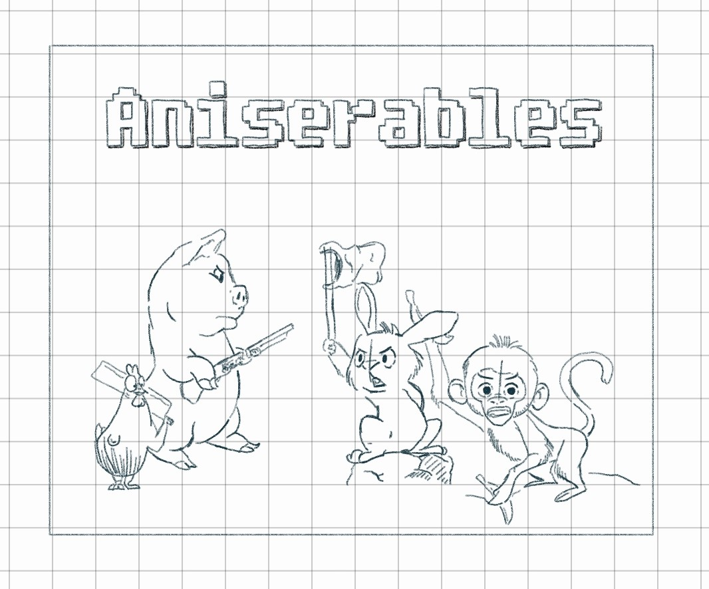
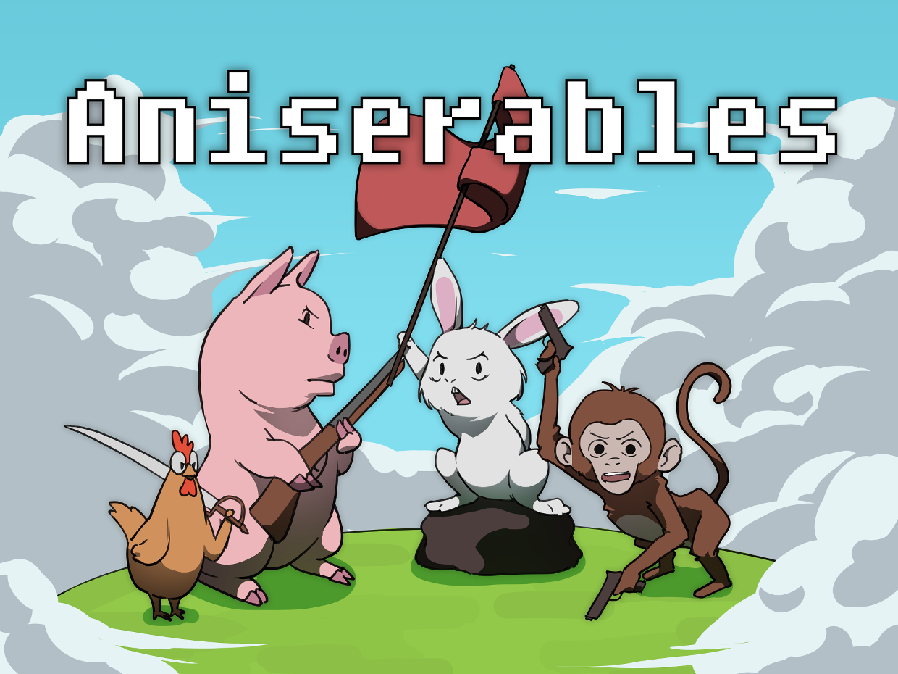

- **플레이어 AI**: 기존 뱀서류의 플레이어 역할은 코드로 구현해, 실제 유저가 조작하는 것처럼 움직이게 했습니다. 이 AI도 일반 뱀서류처럼 특성을 찍고 무기를 업그레이드합니다.
- **전략성**: AI의 무기 업그레이드와 특성 선택에 맞춰, 그에 대처할 수 있는 몬스터를 여러 가지로 조합하는 것이 핵심입니다.
- **성장 요소**: 유저도 몬스터를 조합하거나 업그레이드할 수 있으며, 로그라이트 형식으로 매판 새로운 재미를 제공합니다.
- **확장 계획**: 이후 Photon 2를 이용해 1:1 대전 모드를 만들 계획이었으나, 개발 중 팀이 해체되어 구현하지 못했습니다.

저는 개발과 서브 디자인을 담당했고, 기획서를 직접 작성하며 투자 유치를 위한 BM과 시장 분석도 함께 진행했습니다. 이 아이디어로 코코네스쿨 1기 최종 평가에도 합격했습니다.

#### 1.4.2. HIM
> 2023-02 ~ 2023-05 · 3명 · 개발, 디자인

자세히 보기

**[HIM](https://github.com/HongDaHyun/HIM)**: '하이아임'의 줄임말로, 옛날 미니홈피처럼 자기 캐릭터를 꾸미고 성격과 취미를 보여주는 SNS 성향의 플랫폼입니다. 게임이 아닌 서비스였고, 인스타그램 이용층을 타겟으로 했습니다.

- **컨셉**: 나만의 캐릭터를 중심으로 자신을 표현하고 공유하는 공간
- **BM**: 캐릭터 커스터마이징 기능(옷, 액세서리 등)을 수익 모델로 설계
- **타겟**: 인스타그램 이용층

저는 개발과 디자인을 모두 담당했습니다. 서비스가 완성되기 전에 팀이 해체되어 개발을 마무리하지 못했지만, 이 경험을 통해 제가 가장 몰입하는 일은 게임 개발이라는 점을 확인했습니다.

#### 1.4.3. CookieLabs
> 2023-11 ~ 2024-06 · 스타트업 초기멤버 (무급, 사업자 등록 전) · 개발

자세히 보기

코코네스쿨에서 알게 된 지인이 만든 스타트업으로, 블록체인과 웹3 환경에서 탈중앙화 애플리케이션을 만들던 회사입니다. 저는 초기 멤버로 합류해 게임 개발을 맡았고, 총 2개의 게임을 제작했습니다.

- **[슬라임팡팡](https://github.com/cookie-labs/SlimePangPang)**: 안드로이드용으로 만들었던 게임을 웹게임으로 추가 빌드하고, 텔레그램 API를 연동해 가상화폐와 NFT 디자인 요소를 넣었습니다.

  ▶ 이미지 클릭 시 영상 다운로드  
  <a href="assets/slimepangpang_trailer.mp4">
   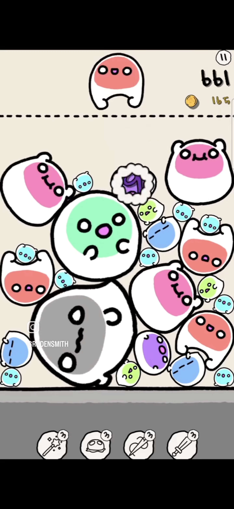
  </a>
  
- **[머지슬라임](https://github.com/cookie-labs/MergeSlime)**: 텔레그램 API를 활용한 방치형 웹게임을 새로 제작했습니다.

   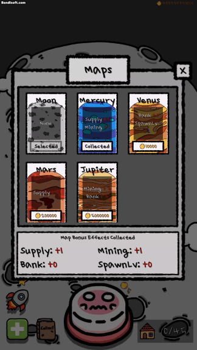

이 두 게임으로 텔레그램과의 미팅을 성공적으로 마쳐, 스토어에 정식 등록해도 좋다는 허락을 받았습니다. 당시 기준으로 국내에서 텔레그램 스토어 입점에 성공한 곳은 저희 회사뿐이었습니다.
  
> 아래 이미지는 실제 화상미팅 장면 캡처본이고, 초상권을 위해 얼굴은 가렸습니다.

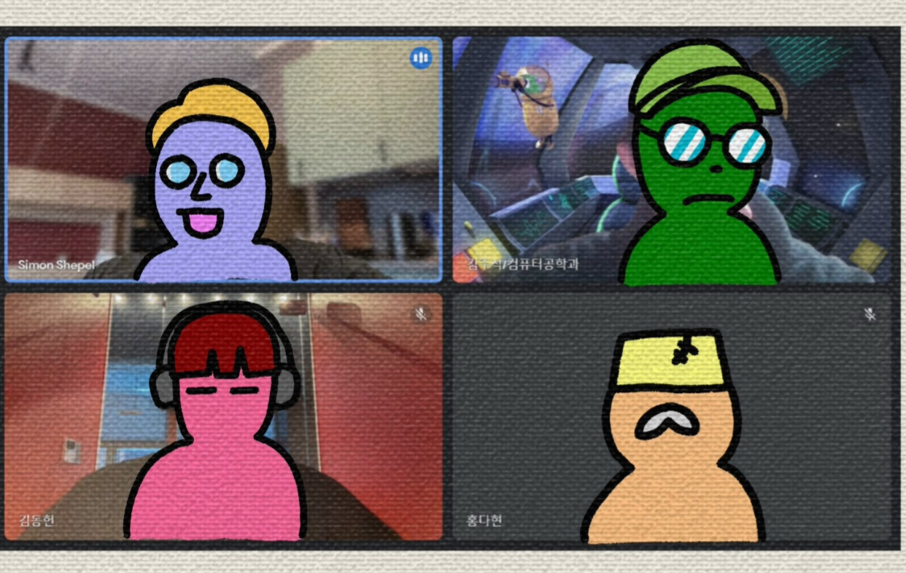

#### 1.4.4. TurtleRun
> 2024-03 ~ 2024-06 · 4명 · 개발(메인화면·미니게임, 코드 통합), 디자인

자세히 보기

**[TurtleRun](https://github.com/gachon-gamemakers)**: 레이싱 게임에 AI 모델을 접목한 게임입니다. 플레이어가 직접 운전하는 대신, 학습된 AI 모델이 자율주행으로 달리고 플레이어는 어떤 모델을 고르고 키울지 전략을 세웁니다.

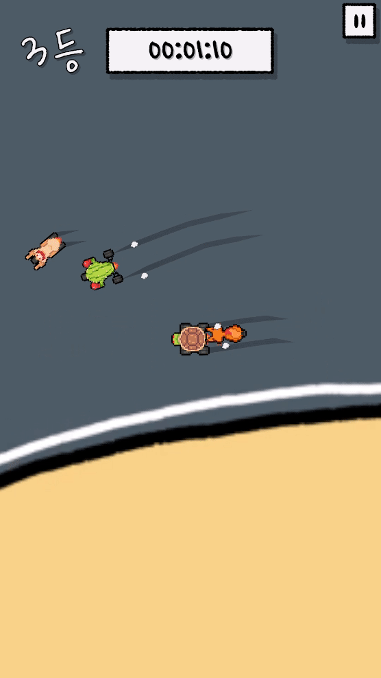
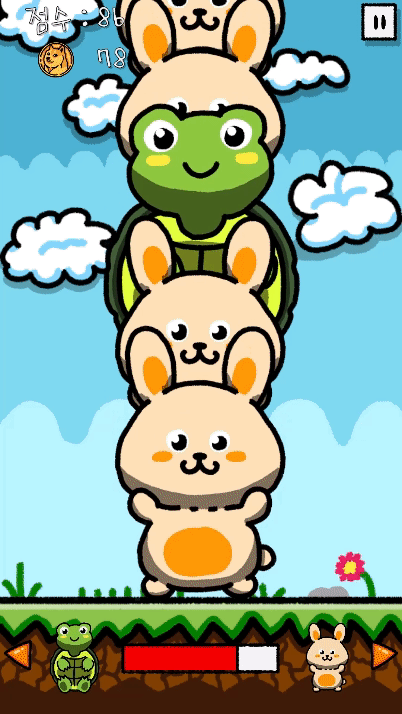
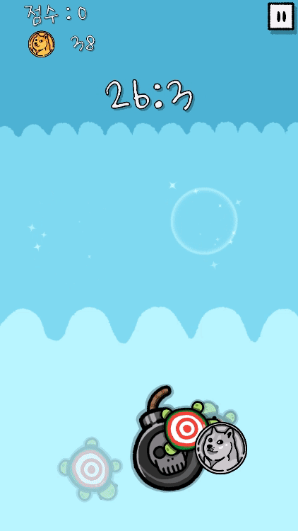
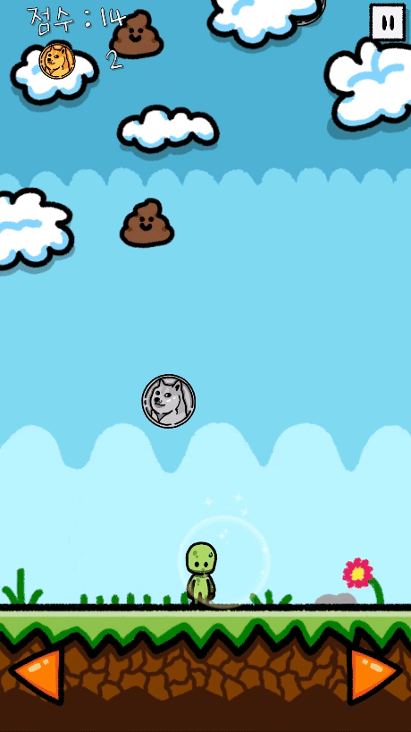

- **재화 획득**: 미니게임을 플레이해 재화를 모읍니다.
- **모델 구매·업그레이드**: 재화로 학습된 AI 모델을 구매하고 업그레이드합니다.
- **모델마다 다른 성향**: 이곳저곳 부딪히는 AI, 커브에서 브레이크를 세게 밟는 AI, 항상 액셀만 밟는 AI처럼 성향이 제각각입니다.
- **전략과 경쟁**: 맵 구조에 맞는 모델을 선택·업그레이드해 다른 플레이어와 기록 경쟁을 합니다.

저는 메인화면과 미니게임 개발, 팀원 코드 통합을 맡았고, 아트는 전부 혼자 제작했습니다. AI 모델 학습은 팀원이 주로 담당했고, 저는 학습된 모델이 게임 안에서 동작하도록 통합하는 작업에 참여했습니다. 졸업작품 평가단에게 좋은 평가를 받았고, 특히 디자인 부문에서 높은 평가를 받았습니다.

  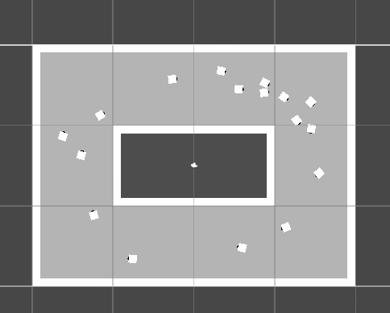
  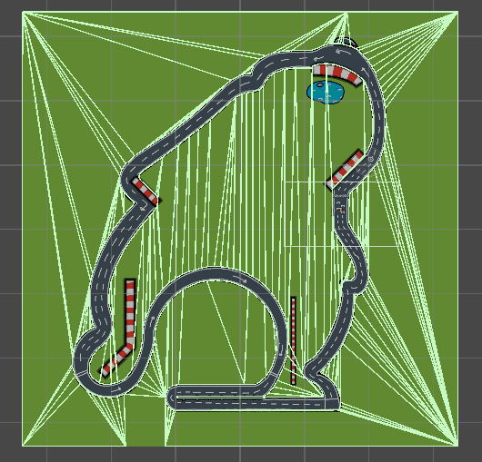
  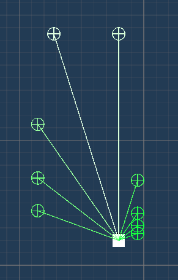

  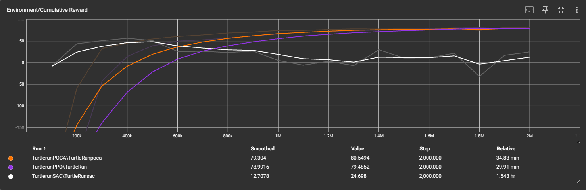

#### 1.4.5. Boulangerie
> 2024-11 ~ 2025-03 · 유럽어문학과 협업 · 개발

자세히 보기

**[Boulangerie](https://github.com/daaexkim/Boulangerie)**: 슬라임팡팡과 같은 수박게임 장르로, 프랑스어 학습을 돕기 위해 만든 게임입니다. 한국인에게 어렵게 느껴지는 프랑스어 명사의 성(남성, 여성) 구분을 게임으로 익힐 수 있게 합니다.

- **규칙**: 수박 대신 프랑스의 빵이 등장하고, 빵마다 남성명사나 여성명사 중 하나가 붙어 있습니다. **같은 성의 빵끼리만 합쳐지기** 때문에, 플레이하면서 자연스럽게 명사의 성을 구분하게 됩니다.
- **3가지 모드**: 명사가 없는 일반 수박게임 모드, 남성명사는 파란색·여성명사는 핑크색으로 구분해 보여주는 초보자 모드, 색 표시 없이 직접 구분해야 하는 고급자 모드로 학습 수준에 따라 난이도를 나눴습니다.
- **단어 관리**: 단어 목록을 CSV 파일로 관리해, 프랑스어 전공 팀원이 만든 데이터를 코드 수정 없이 게임에 반영할 수 있게 했습니다.
- **점수 경쟁**: 구글 클라우드 서비스를 이용해 플레이어 간 점수 경쟁 기능을 구현했습니다.

  ▶ 이미지 클릭 시 블랑제리 소개 게시물로 이동  
  <a href="https://www.instagram.com/p/DDraeqxSLCh/?img_index=1">
    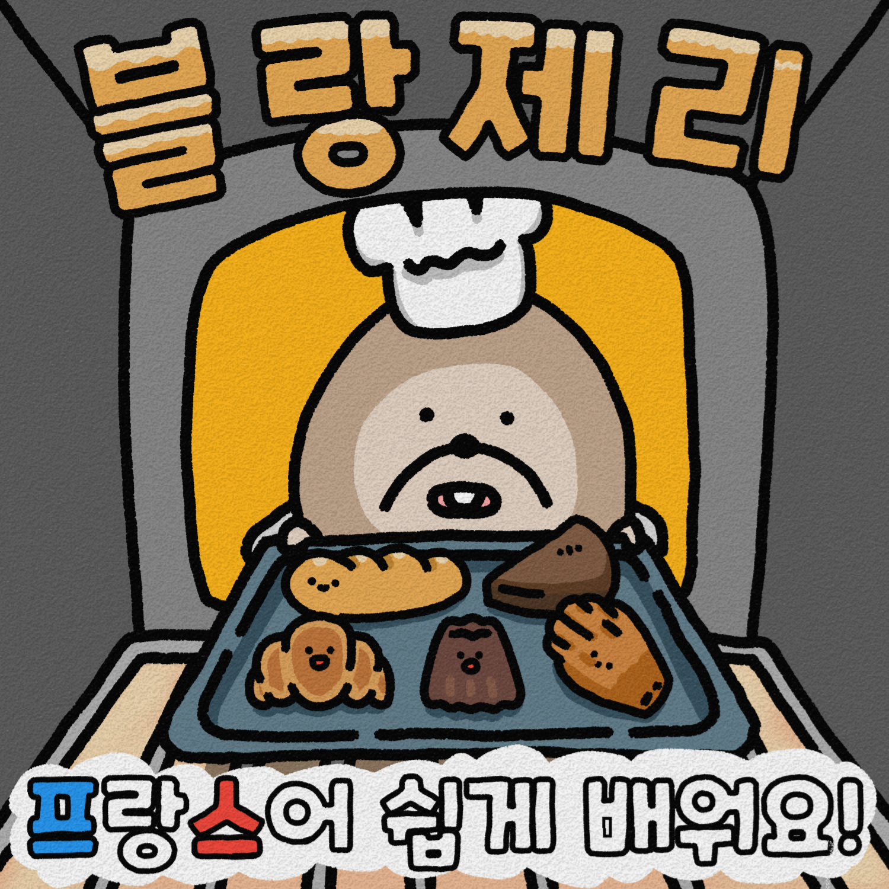

유럽어문학과(프랑스어) 학생의 졸업작품으로, 기획과 디자인은 그 친구가, 개발은 제가 전담했습니다. 그 학과에서 게임을 개발하는 학생은 그 친구 한 명뿐이었고, 서로 다른 전공이 만나 학습 도구를 게임으로 풀어낸다는 제안이 재미있어 수락했습니다.

### 1.5. Personal Projects
- 총 단독 프로젝트 경험: 약 29개월

※ 군 복무 중 스토어 정책 요건을 충족하지 못해, 출시했던 게임은 현재 모두 스토어에서 내려간 상태입니다.

Project | Start Date | Finish Date | Platform | Genre | Status
--------|------------|------------|-------|-----------------|----
군 비기 "침상 점프" | -          | 2022-03    | Android | 클리커(유명 유튜버 팬게임) | 출시완료
RetroSurvivor | 2022-06 | 2022-09 | Android | 뱀서류 | 개발중단
RTD | 2023-02 | 2024-12 | Android | 랜타디 + 로그라이크 | 출시완료
KingsUp | 2023-07 | 2023-08 | Android | 플랫폼 게임 | 출시완료
ChessDodge | 2023-08 | 2024-04 | Android | 체스판 위 턴제 피하기 | 개발중단
Tactics Adventure | 2024-01 | 2024-03 | Android | 턴제 전략 카드 퍼즐 게임 | 보류
Cooking Vampire | 2024-10 | 2025-04 | PC | 뱀서류 + 요리 경영 시뮬레이션 | 보류

<b>군 비기 "침상 점프"</b> · 클리커 · Android · 2022-03

 

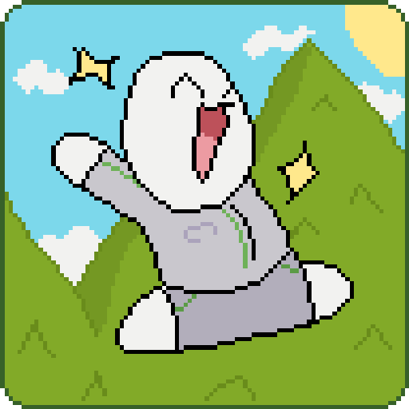
  
제가 처음으로 출시한 게임입니다. 대형 유튜버 고누리 님의 영상 「군 비기 "침상 점프"」를 게임으로 만든 팬게임으로, 허락을 받고 제작했습니다. 방식은 옛날 플래시게임 '선생님 몰래 춤추기'를 모티브로 한 클리커입니다.

게임 개발을 공부하던 중 실제로 게임을 출시해보는 경험을 얻고 싶어서, 범위를 아주 단순하게 잡아 약 3일 만에 스토어 등록까지 마쳤습니다.

- **결과**: 별도 마케팅 없이 약 350명의 설치자를 확보했습니다.
- **운영**: 완성도가 아쉬운 게임이라 유튜버께 피해가 갈까 염려되어, 약 2주 뒤 스토어에서 내렸습니다.
- **배운 점**: 구글 애드몹 광고를 직접 붙여보고 안드로이드 SDK에 익숙해졌으며, 기획부터 스토어 등록까지 한 사이클을 처음 경험했습니다.

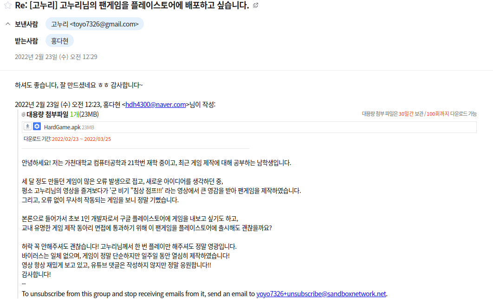
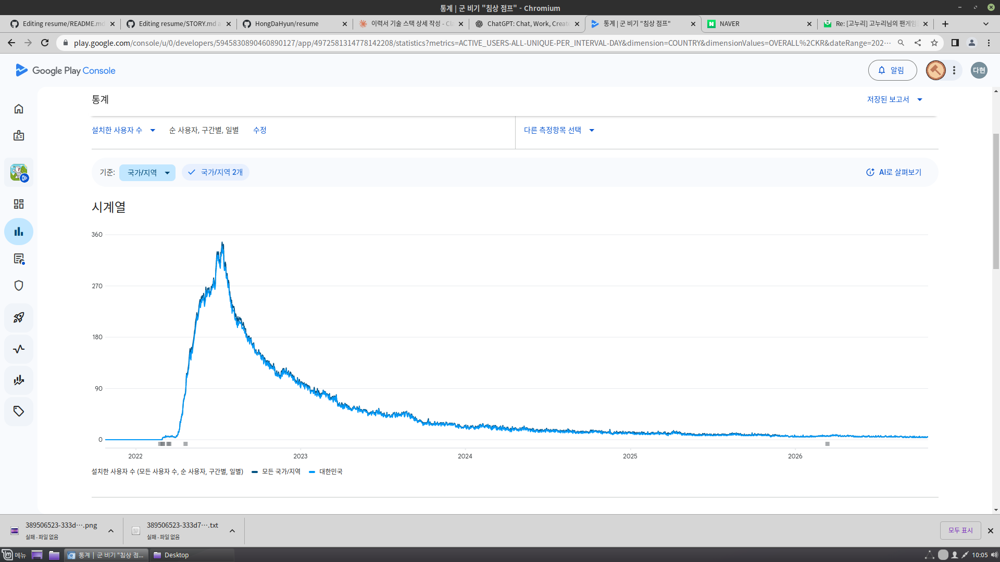

<b>RandomTowerDefense</b> · 랜덤 타워디펜스 + 로그라이크 · Android · 2023-02 ~ 2024-12

 

랜덤 타워디펜스에 로그라이트 요소를 더한 게임으로, 몬스터 웨이브를 20까지 막아내면 승리합니다. 마지막 웨이브에는 보스 몬스터가 등장하는 등 애착을 가지고 만든 작품입니다.

   
- **타워 뽑기**: 열쇠를 사용해 활, 격투, 불, 독, 권총, 칼, 얼음, 번개 8가지 종류의 타워를 무작위로 뽑습니다.
- **합성**: 같은 타워를 합쳐 한 단계 업그레이드된 새로운 종류의 타워를 얻습니다.
- **열쇠 획득**: 웨이브가 끝나면 자동으로 지급되고, 퀘스트를 클리어하면 추가로 얻어 더 다양한 타워를 뽑을 수 있습니다.
- **특성 선택**: 몬스터를 처치해 레벨업할 때마다 무작위로 뜨는 3개의 특성 중 하나를 고릅니다. 특정 타워의 스탯을 올리거나, 번개 타워에 스턴을, 독 타워에 방어력 감소를 부여하는 식이며, 특성 간 시너지로 자신만의 빌드를 만들 수 있습니다.

**반응**: 주변에서 좋은 반응을 얻었고, [인스타그램](#321-instagram)에서 좋아요 100개 이상을 받았습니다. 구글 플레이 콘솔 기준으로 하루 최대 72명이 설치를 유지했고, 이는 유명인의 도움 없이 혼자 힘으로 모은 제 게임 중 가장 많은 수치입니다.
 

**개선**: 이용자들에게 레벨 디자인과 최적화에 대한 피드백을 많이 받아 이를 해결해나갔습니다.
- **최적화**: 모바일 기기에 맞춘 빌드, 수직동기화 ON/OFF 기능, 파티클 최적화, 컬링 등 새로운 기법을 익히며 적용했습니다.
- **레벨·밸런스**: 레벨 테스트를 많이 진행하기 위해 인스펙터를 테스트하기 편하게 구성하고, 특성 간 밸런스를 맞추는 데 공을 들였습니다.

<b>ChessDodge</b> · 체스판 위 턴제 피하기 · Android · 2023-08 ~ 2024-04

 

체스판 위의 폰이 되어 다양한 체스 말의 공격을 피하는 턴제 피하기 게임입니다. 킬링타임용으로 만들었습니다.

- **적**: 실제 체스 말이 등장하고 공격 방식도 원작을 따릅니다. 룩은 일직선으로, 비숍은 대각선으로, 퀸은 사방으로 공격합니다.
- **패턴**: 말이 무작위로 등장하거나, 일부 칸만 남기고 나머지 칸에 하늘에서 말이 떨어지는 등 다양한 패턴을 구성했습니다.

**마케팅 판단**: 처음에는 [디시인사이드 인디게임개발 마이너 갤러리](#324-dcinside)에 개발일지를 올렸습니다. 하지만 이용자층이 게임 개발자뿐이라 잠재 사용자를 얻기 어렵다고 판단했고, 잠재 사용자가 더 많고 반응도 좋은 인스타그램으로 채널을 옮겼습니다.

**중단 이유**: 버그가 잦았고, 게임이 단순해 재미가 부족했는데 이를 기획력의 한계로 판단했습니다. 마침 [CookieLabs](#143-cookielabs)에서 합류 제의가 와서, 새 프로젝트에 집중하기 위해 개발을 중단했습니다.

▶ [클릭](https://www.instagram.com/p/Cv_q3epyyS_/?xtok=OHY2c3NmaGnyajE0)하면 인스타그램 기획 게시물으로 이동합니다.

<b>Tactics Adventure</b> · 턴제 전략 카드 퍼즐 · Android · 2024-01 ~ 2024-03

 

3x3 그리드에 카드를 배치하는 '던전 카드' 장르의 모바일 게임입니다. 플레이어 카드를 십자 방향으로 이동하며 몬스터를 처치하고, 최종적으로 보스를 쓰러뜨리는 것이 목표입니다.
  
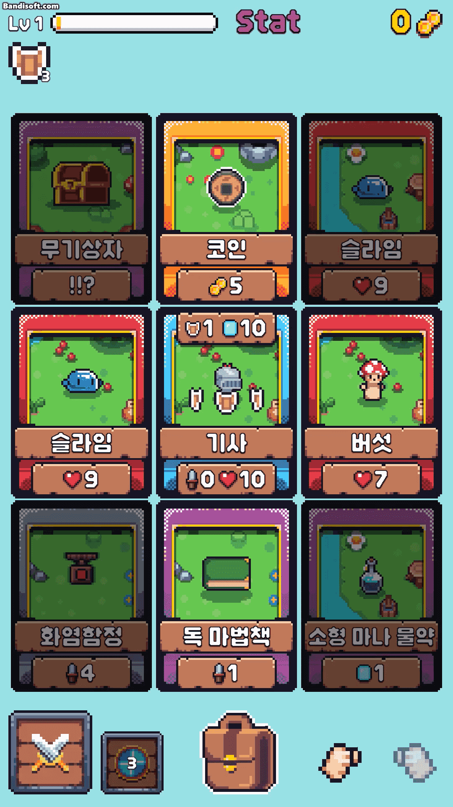  

- **무기**: 무기 카드를 주워 공격력을 올립니다. 사용 횟수가 정해져 있어서 아껴 쓰는 판단이 필요합니다.
- **전투**: 몬스터 카드로 이동했을 때 몬스터의 체력이 플레이어의 공격력보다 높으면 그 차이만큼 플레이어의 체력이 줄어듭니다. 방어도가 있으면 방어도가 먼저 감소합니다.
- **상자**: 열면 아이템, 몬스터, 코인, 무기, 유물 중 하나가 나옵니다.
- **유물**: 이 게임의 핵심 요소입니다. 최대 체력이나 운 같은 단순 스탯 증가부터, 필드의 카드를 무작위로 섞거나 모든 카드에 데미지 1을 주는 즉발 효과, 공격 반사, 적 처치 시 가챠로 추가 보상을 주는 능력까지 다양합니다. 다른 유물과 함께 있으면 시너지가 나는 것도 있습니다. 추가적인 설명은 [링크](https://www.instagram.com/p/C3r5VcoNGhz/?utm_source=ig_web_copy_link&exln=MzRlODBiNWFlZA==&srtk=MzRlODBiNWFlZA==)을 클릭하세요.

**유물의 설계 의도**: 유물이 이롭기만 한 것은 아닙니다. 중독 디버프를 영구적으로 얻는 것처럼 부정적인 유물도 있지만, 잘 조합하면 오히려 높은 시너지를 냅니다. 예를 들어 중독 디버프를 얻는 유물을 먹었더라도, 중독 효과를 크게 늘리고 중독과 회복의 효과를 서로 바꿔주는 유물과 함께 쓰면 매번 체력이 회복되는 조합이 됩니다.

**반응과 현재**: 아기자기하고 귀여운 디자인, 직관적인 UI, 좋은 아이디어로 SNS 팔로워들에게 높은 기대를 받았습니다. 다만 당시 졸업작품을 준비하느라 바빠 개발을 잠시 멈췄고, 이후 새로운 프로젝트 아이디어가 떠올라 묵혀두고 있지만 나중에 꼭 완성하고 싶은 게임입니다.

<b>Cooking Vampire</b> · 뱀서류 + 요리 경영 시뮬레이션 · PC(Steam) · 2024-10 ~ 2025-04

 

낮과 밤이 나뉘는 게임으로, 낮에는 뱀파이어 서바이벌류, 밤에는 요리 경영 시뮬레이션을 즐기는 하이브리드 게임입니다.

- **낮 (뱀서류)**: 모험가가 되어 몰려오는 몬스터를 처치하며 요리 재료를 구합니다. 레벨업하면 스탯이 오르고 다양한 아이템을 얻습니다.
- **밤 (요리 경영)**: 셰프가 되어 낮에 구한 재료로 요리를 만들어 손님에게 대접합니다. 예를 들어 고블린을 잡아 얻은 고블린 귀로 고블린 귀 스테이크를 만들 수 있습니다.
- **성장 루프**: 음식을 팔아 번 돈으로 더 높은 던전을 탐험하고, 좋은 재료를 얻기 위해 모험가의 장비를 강화하며, 더 많은 수익을 위해 레스토랑의 등급과 편의시설을 업그레이드합니다.
- **콘텐츠**: 전사, 궁수, 도적, 마법사 4종의 캐릭터와 고블린, 슬라임, 뱀파이어, 스켈레톤 등 전형적인 판타지 몬스터가 등장합니다. 던전마다 고유한 보스 몬스터가 있고, 다양한 퀘스트와 NPC도 준비했습니다.

**플랫폼 전환**: 처음에는 모바일 게임으로 만들려 했지만, 게임 볼륨이 커지고 기획이 확장되면서 Steam 플랫폼으로 방향을 전환했습니다.

**현재**: 낮(뱀서류) 파트는 기능 구현을 거의 마쳤고, 밤(요리 경영) 파트는 식당 구현과 일부 요리 방식까지 만든 상태에서, 군 입대로 개발을 잠시 보류했습니다. 또한 군 복무 중 이 저장소가 DMCA 신고로 내려갔습니다. 구매해서 사용한 올인원 에셋이 공개 저장소에 그대로 포함되어 있어 에셋 제작자가 신고한 것으로, 라이선스상 원본 에셋을 공개해서는 안 된다는 점을 놓친 제 불찰이었습니다. 전역 후 바로 해당 에셋을 제외하고 저장소를 정리해 복구할 예정이며, 이후로는 유료 에셋을 저장소에서 분리해 관리할 예정입니다.

▶ 이미지 클릭 시 소개 영상 링크로 이동  
<a href="https://www.instagram.com/reel/DFBzbyihv-b/?utm_source=ig_web_copy_link&exln=MzRlODBiNWFlZA==&srtk=MzRlODBiNWFlZA==">
  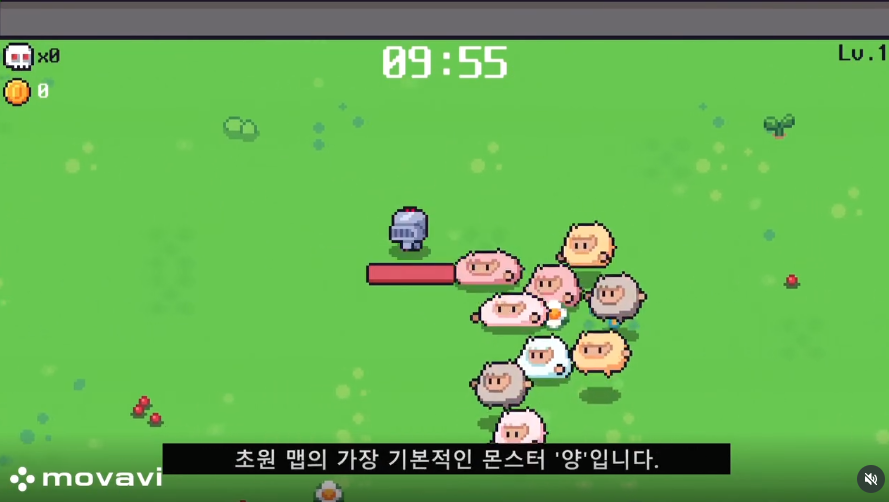
</a>

## 2. Introduction
### 2.1. Where It Began
저는 15살에 C++로 프로그래밍을 시작했습니다. 처음에는 온라인 코딩 문제 사이트에서 문제를 풀며 기초를 익혔고, 고등학교에서 3D 프린터 동아리장을 맡아 아두이노로 펌프 패드를 만들면서 본격적으로 코딩에 빠져들었습니다.
패드의 버튼 입력을 키보드 입력과 연동하는 단순한 코드였지만, 동아리 페스티벌에서 좋은 반응을 얻어 CAD로 도면을 개선하는 등 열정적으로 임했습니다. 이 경험을 계기로 프로그래밍은 저의 취미가 되었습니다.

20살부터는 유튜브, 스택오버플로우, 블로그를 통해 게임 개발을 독학했습니다. 수많은 버그와 시행착오 끝에, 대형 유튜버 고누리 님의 허락을 받은 팬게임([군 비기 "침상 점프"](#14-personal-projects))을 처음으로 완성해 출시했습니다.
지금 보면 그래픽과 디자인은 부족한 클리커 게임이고 코드도 스파게티에 가깝지만, 기획부터 출시까지 끝까지 완성해낸 값진 경험이었습니다. 이 게임을 시작으로, 군 복무 전까지 쉬지 않고 개발을 이어왔습니다.

### 2.2. Self Improvement
게임 개발을 포함해 제가 다루는 대부분의 기술은 독학으로 익혔습니다. 유튜브와 스택오버플로우, 블로그, 공식 문서를 찾아보고, 코드를 직접 뜯어보고, 수많은 버그와 디버깅을 거치며 배웠습니다.

궁금한 것은 바로 만들어보며 확인하는 즉흥적인 성격이고, 누군가에게 의존하기보다 스스로 해결하는 편이 편했습니다. 그 덕분에 시간과 장소 같은 환경에 구애받지 않고, 막히는 문제도 자기주도적으로 풀어낼 수 있게 되었습니다.

### 2.3. Solo Indie Development
게임 제작을 시작하며, 개발 외에도 다양한 역량이 필요하다는 것을 알게 되었습니다. 특히 대부분의 프로젝트를 혼자 진행했기 때문에 기획, 마케팅, 디자인까지 스스로 익혀왔습니다.

[마케팅](#42-Marketing) 역량을 기르기 위해 Meta 광고·비즈니스 도구와 영상 편집, 메디방(인스타툰 제작)을 공부했고, [기획](#43-Planning)은 실제 게임 회사의 기획서를 참고해 직접 작성해보며 탄탄히 다졌습니다.
[디자인](#41-Design)은 게임에 들어가는 이미지 스프라이트, UI 등을 Aseprite와 손그림으로 직접 제작해보며 실력을 키웠습니다.

### 2.4. Documentation
저는 프로젝트를 진행할 때 문서화를 놓치지 않습니다. 혼자 개발하는 일이 많아 문서화가 크게 필요하지 않다고 생각할 수 있지만, 백업을 위해서도 중요하고, 무엇보다 노트북으로 밖에서 작업하는 일이 많아 여러 환경 사이의 작업 상태를 동기화하려면 문서화가 필수였습니다.

기록을 남겨두니 코드의 오류와 업데이트 상황을 한눈에 확인할 수 있었고, 지난 작업을 되짚을 때도 기억이 아닌 기록에 근거해 판단할 수 있었습니다.
개발뿐 아니라 기획과 디자인, 마케팅까지 SNS, 전자문서 등 어떤 형식으로든 기록하는 습관 덕분에, 이 이력서 역시 부담 없이 작성할 수 있었습니다.

이 습관은 팀 프로젝트에서도 좋게 작용했습니다. 작업 내용과 진행 상황을 공유할 수 있는 형태로 정리해두다 보니, 역할을 나누고 맞춰가는 분업이 어색하지 않았습니다.

### 2.5. Performance and Code Quality
저는 개발할 때 최적화를 매우 중요하게 여기며, Unity Profiler, Memory Profiler, Frame Debugger로 병목을 먼저 측정한 뒤 개선합니다.

- **메모리·CPU**: 오브젝트 풀링과 캐싱으로 GC를 최소화하고, LINQ·박싱·문자열 연산을 지양합니다. Update문 사용을 줄여 코루틴과 이벤트 기반으로 설계하고, 릴리스 빌드에서는 Debug.Log를 제거합니다. 물리 연산은 Layer Collision Matrix를 정리하고 불필요한 Collider·Rigidbody를 없애 부하를 줄입니다.
- **디자인·그래픽**: 스프라이트 아틀라스로 드로우콜을 줄이고, 같은 색은 하나로 통일하며 스프라이트 크기를 16px, 32px 등으로 맞춥니다. 텍스처 압축과 임포트 설정(Max Size, Mipmap, Read/Write)을 조정하고, 컬링, 오버드로우 줄이기, 셰이더 경량화, 파티클 최적화를 적용합니다. UI는 Canvas를 분리하고 불필요한 Raycast Target을 꺼서 관리합니다.
- **사운드·빌드**: 효과음과 BGM의 로드 방식·압축 포맷을 구분하고, Addressables와 비동기 로딩으로 로딩 부담을 줄입니다. 빌드 최적화 설정을 적용하며, 수직동기화(VSync) 기능 구현과 프레임레이트 캡으로 모바일 발열과 배터리를 관리합니다.

### 2.6. Assets and Tools
저는 게임 한 편을 만들 때 약 20~30개의 에셋을 활용합니다. 직접 만들 필요가 없는 기능은 검증된 에셋으로 빠르게 해결하고, 그 시간을 게임 고유의 재미를 만드는 데 씁니다.
iPools로 오브젝트 풀링을 구성하고, DOTween으로 UI 애니메이션을 제작하며, Odin Inspector로 인스펙터의 가독성을 높여 레벨 테스트가 편한 형태로 구성합니다.
특히 웨이브와 스탯을 즉시 바꾸거나 몬스터와 아이템을 바로 소환하는 기능을 자주 구현해, 에디터 안에서 레벨과 밸런스를 검증합니다.

여기에 더해, 프로젝트마다 반복되는 작업은 직접 코드로 만들어 재사용합니다.
CSV 파일을 유니티에서 읽을 수 있게 하는 CSVReader를 직접 제작해 게임 데이터 관리에 활용하고, 싱글톤을 쉽게 만들어주는 Singleton은 매니저처럼 전역에서 하나만 필요한 클래스에만 한정해 사용합니다.

### 2.7. Recent Update
현재 공군 전산병으로 복무 중이며, 2027년 1월 전역을 앞두고 있습니다.

복무 기간을 그냥 흘려보내지 않았습니다. 군 내 SMS(Service Management System)를 개발했고, 이 프로그램은 현재 전 비행단에서 활용되고 있습니다. 또한 정보통신경연대회에서 3스타(참모총장상)를 수상했습니다.
  

보안이 중요한 환경 특성상 게임 개발은 잠시 멈췄지만, 그 시간을 게임과 거리가 먼 분야를 익히는 데 썼습니다. 엑셀과 쉘에 대한 이해를 쌓고, 리눅스 OS와 웹 해킹, 리버싱까지 공부했으며 토익도 꾸준히 준비했습니다. 이렇게 군 복무 중에도 자기계발을 소홀히 하지 않았습니다.

## 3. Beyond Development
### 3.1. Design
픽셀아트, 손그림, 이펙트 디자인까지 세 가지 분야를 직접 디자인할 수 있습니다. 학교나 학원에서 배운 적 없이 모두 독학으로 익혔고, 유튜브 영상과 블로그, 레딧의 팁을 참고하며 직접 그려보고 시행착오를 거쳐 터득했습니다.

[Pixel Art](#311-pixel-art) | Aseprite | 캐릭터, 배경, 아이템 등 도트 그래픽 및 애니메이션 제작
[Hand-drawn Illustration](#312-hand-drawn-illustration) | MediBang Paint | 캐릭터 일러스트 및 애니메이션 손그림 제작

디자인과 개발을 모두 하기 때문에, 둘 사이의 최적화도 직접 해결할 수 있습니다. 스프라이트의 크기와 색을 게임 최적화에 맞춰 제작하고, 유니티 애니메이션에 대한 이해를 바탕으로 애니메이션도 최적화하며, UI 패널도 상황에 맞춰 수정하거나 새로 제작합니다.

#### 3.1.1. Pixel Art
도트 그래픽 게임을 좋아해서, 직접 만들어보고 싶다는 마음으로 시작했습니다.

- **툴과 숙련도**: Aseprite를 수준급으로 다루며, 다양한 단축키와 디자인 팁을 알고 있습니다. 주로 32px x 32px를 작업하지만 해상도를 늘려도 지장 없이 디자인할 수 있습니다.
- **작업 방식**: 대부분 새로운 디자인을 직접 그립니다. 또 itch.io에서 Sunny Valley Studio의 그래픽 에셋을 구매해, 샘플을 수정하여 저만의 새로운 캐릭터로 만들어본 경험도 있습니다.
- **제작 범위**: UI 패널, 아이콘, 버튼은 물론 캐릭터 애니메이션, 무기, 이펙트까지 게임에 들어가는 모든 디자인을 직접 만들 수 있습니다.

아직 더 배울 점은 있지만, Aseprite로 완성도 있는 도트 디자인을 만들어낼 수 있는 수준입니다.  

  
  
  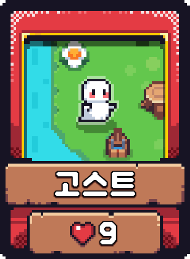
  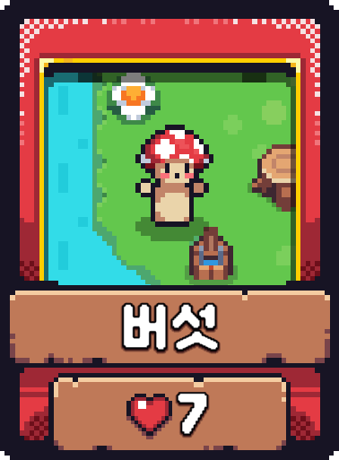
  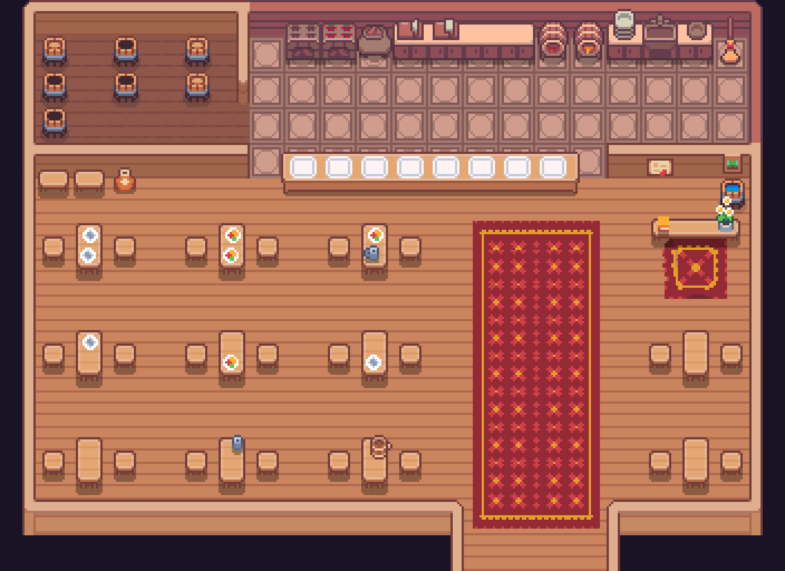
  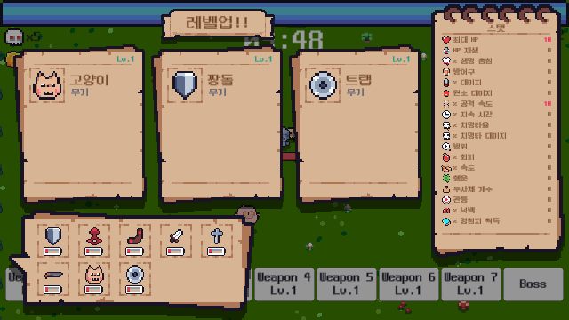

<a href="https://www.instagram.com/p/Cyk4ZdrCjma/?utm_source=ig_web_copy_link&vrfl=MzRlODBiNWFlZA==&srtk=MzRlODBiNWFlZA==">▶ 인스타그램에서 도트 작업물 보기</a>

※ 작업물은 인스타그램에 꾸준히 기록해두었습니다. 군 복무 중이라 원본 파일 대신 해당 게시물로 연결합니다.

#### 3.1.2. Hand drawn Illustration
처음에는 삼성노트로 그림을 그리다가, 점점 익숙해지면서 메디방(MediBang)으로 옮겨 그리기 시작했습니다.

- **인스타툰**: 마케팅을 할 때 개발일지를 인스타툰으로 그려 올리면서 메디방을 가장 많이 사용했습니다.
- **게임 디자인**: 손그림 일러스트 스타일의 게임을 만들 때는 이펙트, 캐릭터, UI, 맵 등 다양한 요소를 직접 그려 게임에 넣었습니다.

<a href="https://www.instagram.com/rudensmith/">▶ 인스타그램에서 손그림 작업물 보기</a>

손그림 작업물은 인스타그램 링크에서 가장 잘 확인하실 수 있습니다.

### 3.2. Marketing
#### 3.2.1. Instagram
인스타그램을 주력 마케팅 채널로 선정하고, Meta Business 계정을 활용해 계정 운영과 콘텐츠 관리를 진행했습니다. 인스타툰, 팔로워 참여형 콘텐츠, 릴스(Reels), 스토리(Stories) 등 다양한 형식의 게시물을 제작해 게임을 홍보하고 팔로워와의 소통을 유도했습니다.

그 결과, **팔로워 200명 이상을 확보했으며, 좋아요 100개 이상을 기록한 게시물**도 달성했습니다. 다양한 콘텐츠 형식을 시도하며 게임의 매력을 전달하는 동시에, 유저의 관심과 참여를 유도하는 콘텐츠의 중요성을 경험했습니다.

현재는 군 복무로 인해 게시물 업로드를 중단한 상태지만, 전역 후 계정을 다시 활성화할 계획입니다. 기존에 활용했던 인스타툰의 비중을 줄이고, 게임 플레이와 핵심 재미 요소를 보다 직관적으로 전달할 수 있는 릴스 중심으로 콘텐츠 전략을 개편하고자 합니다. 이를 통해 게임의 매력을 효과적으로 전달하고, 더 많은 잠재 유저의 유입을 유도하는 것을 목표로 하고 있습니다.
  
▶ 이미지 클릭 시 인스타그램으로 이동합니다.  
<a href="https://www.instagram.com/rudensmith/">
  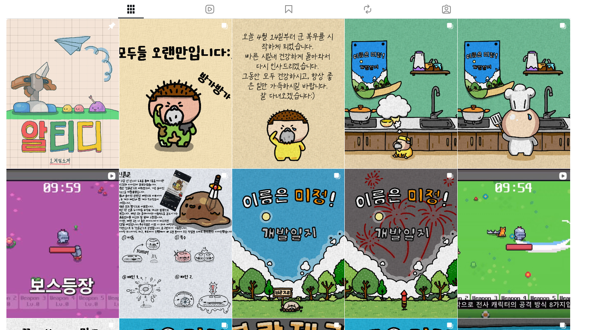
</a>

#### 3.2.2. YouTube
유튜브에서는 게임 플레이 영상을 숏츠(Shorts) 형식으로 제작해 업로드했습니다. 개발과 다른 마케팅 활동을 병행하고 있었기에 주력 마케팅 채널은 아니었고, 상대적으로 많은 시간을 투자하기도 어려웠습니다.

그럼에도 가장 높은 반응을 얻은 영상은 **조회수 9,500회 이상, 좋아요 80개 이상**을 기록했습니다. 예상보다 높은 반응에 놀랐던 기억이 있으며, 이를 통해 짧은 영상만으로도 게임의 재미와 특징을 효과적으로 전달할 수 있다는 가능성을 확인했습니다.

비록 집중적으로 운영한 채널은 아니었지만, 게임 플레이를 짧고 직관적인 콘텐츠로 전달하는 방식이 잠재 유저의 관심을 끌 수 있음을 경험했습니다.

<a href="https://www.youtube.com/@RudenSmith">▶ 유튜브로 바로가기</a>

#### 3.2.3. Trailer Video
게임의 주요 특징과 매력을 효과적으로 전달하기 위해 트레일러 영상을 제작했습니다. 게임 소개와 주요 플레이 장면, 하이라이트 등을 중심으로 영상을 구성해 게임을 처음 접하는 유저도 핵심 재미 요소를 직관적으로 이해할 수 있도록 했습니다.

영상 제작 과정에서는 기초적인 영상 편집 기술을 직접 학습하고 적용했습니다. 이를 통해 게임 개발뿐만 아니라 완성된 게임을 시각적인 콘텐츠로 가공하고, 잠재 유저에게 매력적으로 전달하는 방법도 익힐 수 있었습니다.

<table>
  <tr>
    <td align="center" width="33%">
      <strong>Aniserables</strong>
    </td>
    <td align="center" width="33%">
      <strong>Turtle Run</strong>
    </td>
    <td align="center" width="33%">
      <strong>Cooking Vampire</strong>
    </td>
  </tr>
  <tr>
    <td align="center">
      
    </td>
    <td align="center">
      <a href="assets/turtlerun_trailer.mp4">
        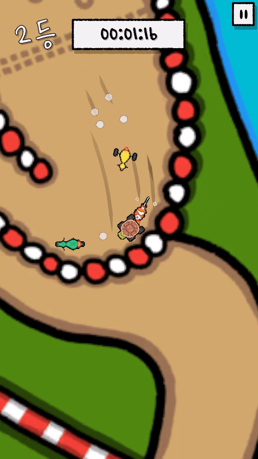
      </a>
    </td>
    <td align="center">
      
    </td>
  </tr>
  <tr>
    <td align="center">📥 영상 다운로드</td>
    <td align="center">📥 영상 다운로드</td>
    <td align="center">▶️ 인스타그램에서 보기</td>
  </tr>
</table>

#### 3.2.4. DCInside
초기에는 디시인사이드 인디게임개발 마이너 갤러리에 개발일지와 게임 스크린샷을 게시하며 프로젝트를 소개했습니다. 총 9개의 게시물을 작성했으며, 그중 4개가 개념글에 선정되는 등 커뮤니티 내에서 긍정적인 반응을 얻었습니다.

다만, 개발자 중심의 커뮤니티 특성상 실제 게임을 플레이할 잠재 유저를 확보하는 데에는 한계가 있다고 판단했습니다. 이에 여러 마케팅 채널의 특성과 활용 목적을 고려해 디시인사이드에서의 게시물 업로드를 중단하고, 보다 많은 잠재 유저와 소통할 수 있는 인스타그램에 마케팅 역량을 집중했습니다.

이 경험을 통해 단순히 게시물을 여러 플랫폼에 배포하는 것보다, **채널별 이용자 특성과 마케팅 목적을 고려해 적합한 플랫폼을 선택하고 운영 자원을 집중하는 것이 중요하다**는 점을 배웠습니다.

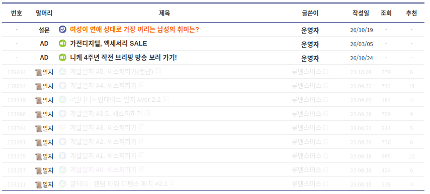

### 3.3. Planning
스타트업 초기 멤버로 활동하고 여러 게임을 개발 및 출시하며 기획의 중요성을 체감했습니다. 초기에는 아이디어 중심으로 기획을 진행했지만, 프로젝트 경험이 쌓이면서 체계적인 기획의 필요성을 깨달았습니다.

이후 실제 기업의 게임 기획서를 참고하며 문서 구성과 작성 방식을 익히고, 이를 프로젝트에 적용하기 위해 노력했습니다. 게임의 핵심 콘셉트와 주요 기능을 구체적으로 정리했으며, 팀 프로젝트뿐만 아니라 개인 개발에서도 기획서 작성을 꾸준히 이어가며 체계적인 개발 과정을 갖추고자 했습니다.

#### 3.3.1. 애니제라블 기획서
※ 관련 파일은 개인 노트북에 보관 중이며, 현재 군 복무로 인해 업로드가 어려운 상황입니다. 추후 휴가 중 업로드할 예정입니다.

#### 3.3.2. 알티디 역기획서
▶ 이미지 클릭 시 문서 다운로드  
<a href="assets/RTD_RED.pdf">
  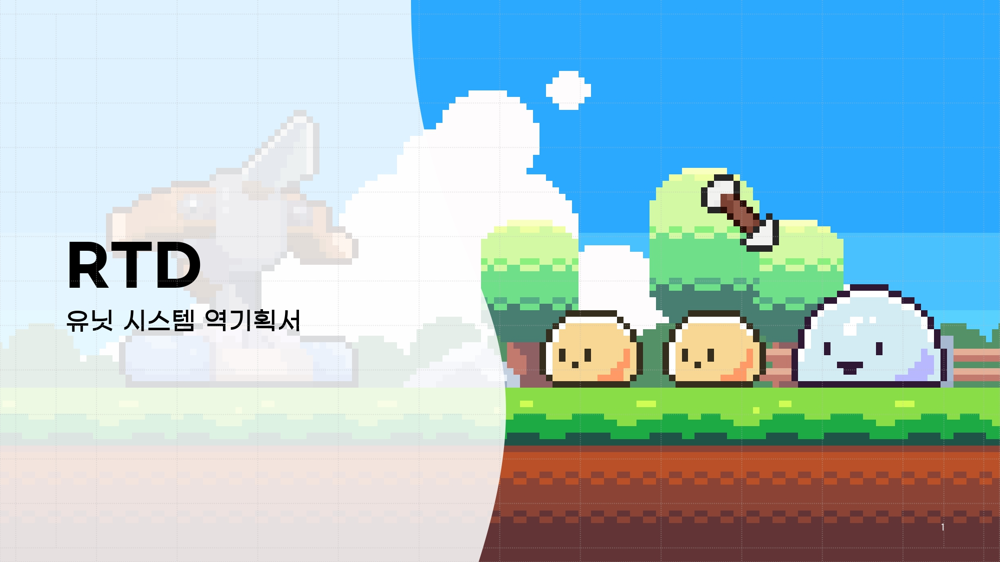
</a>

#### 3.3.3. 택틱스 어드벤처 기획서
▶ 이미지 클릭 시 문서 다운로드  
<a href="assets/tacticsAdventure.pdf">
  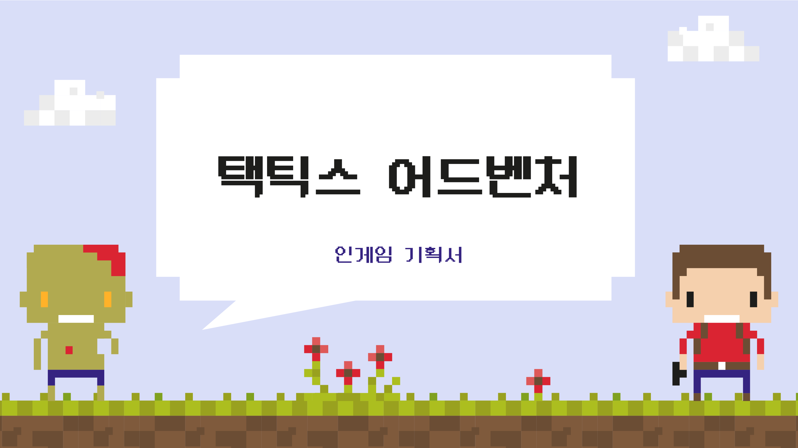
</a>
